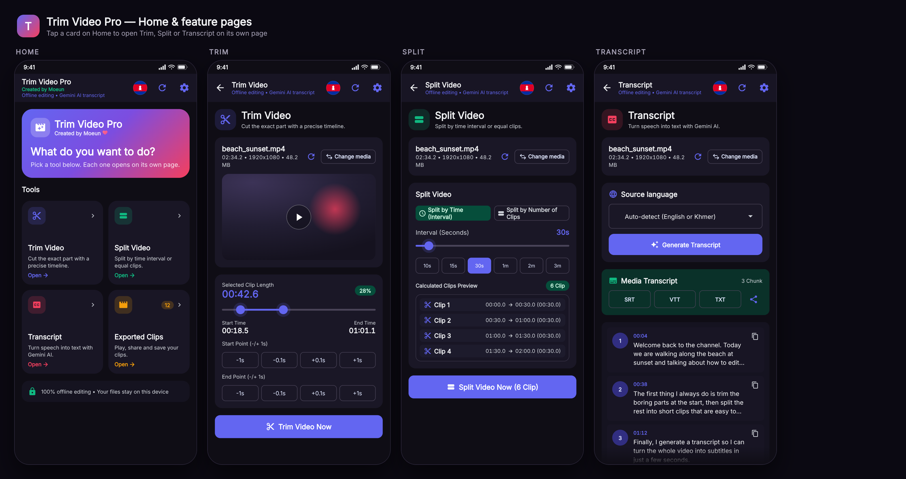
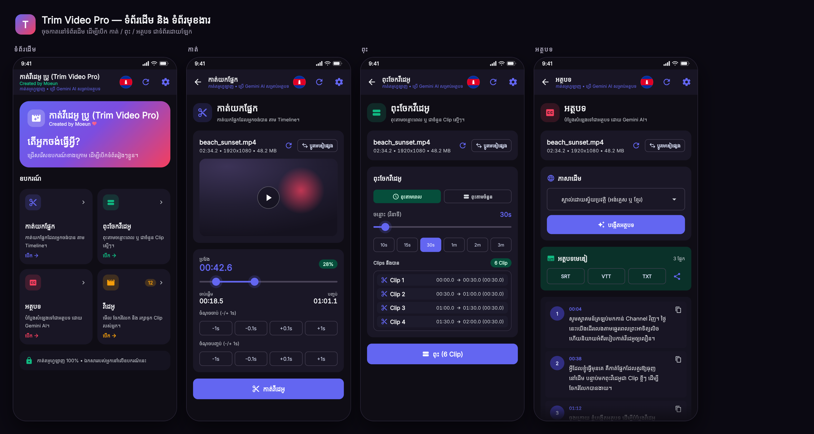
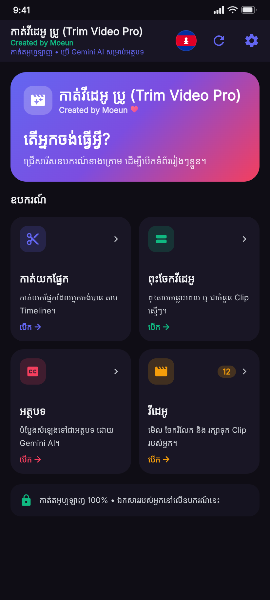
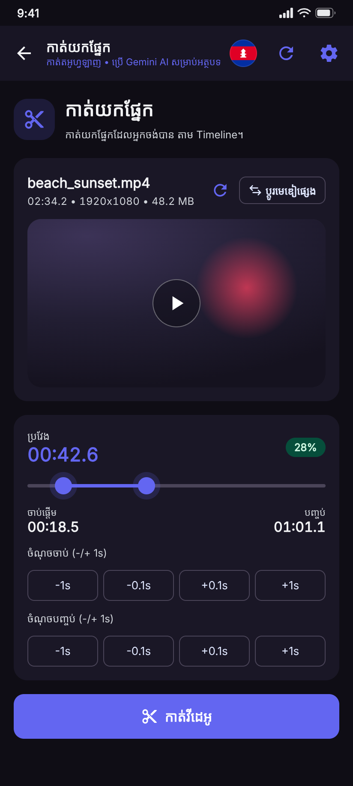
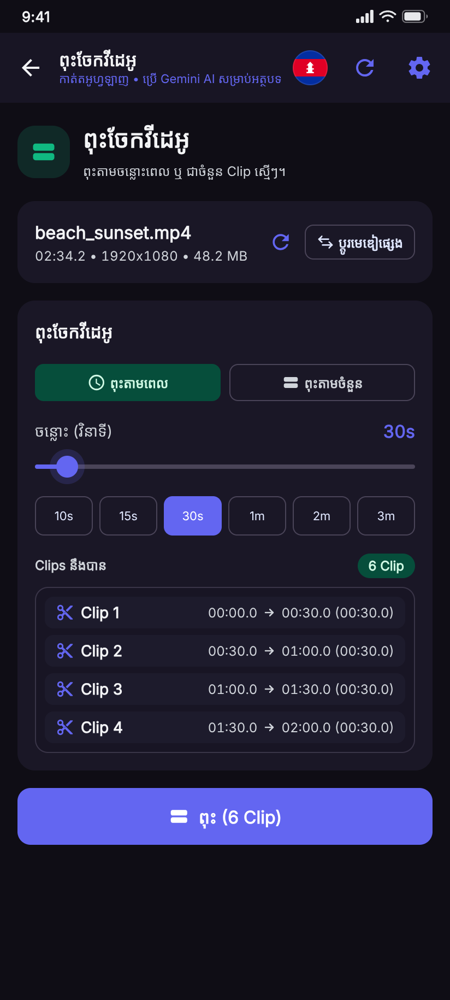
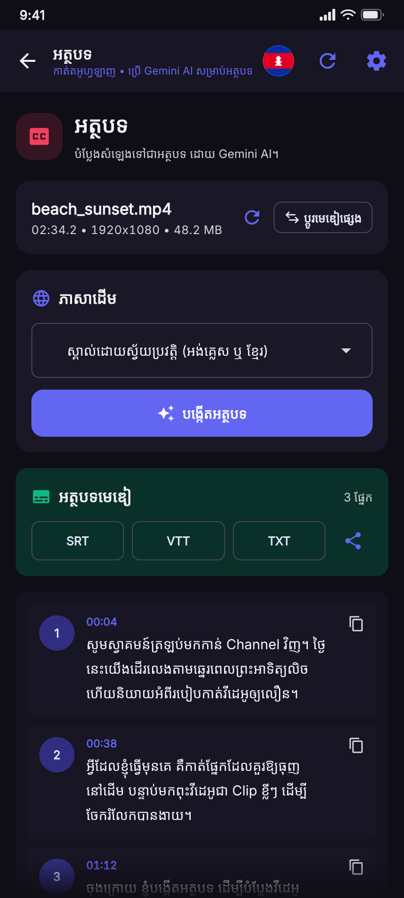
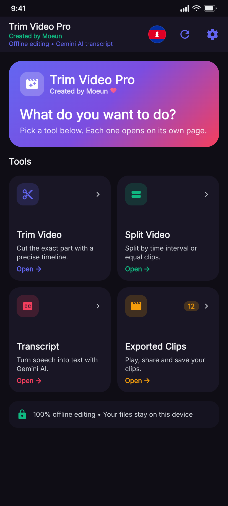
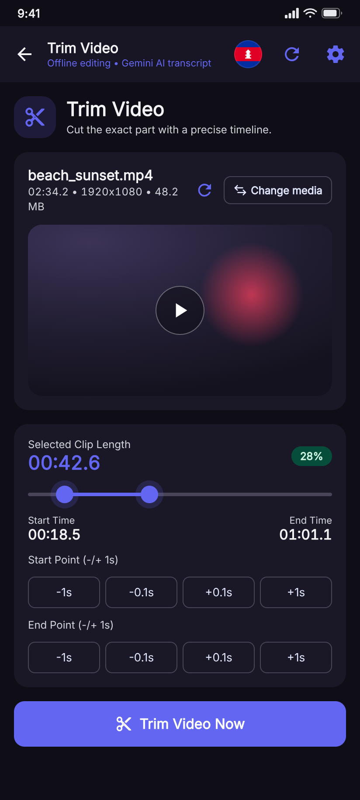
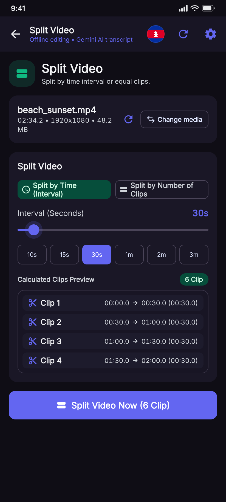
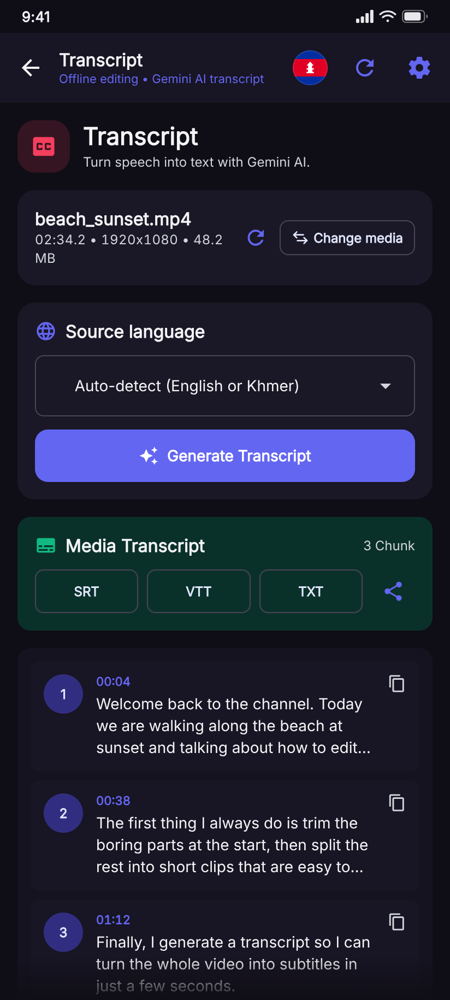

# Trim Video Pro

កម្មវិធីកាត់ និងពុះវីដេអូ អូហ្វឡាញ (Offline) សម្រាប់ Android — គាំទ្រភាសាខ្មែរ និងអង់គ្លេស ព្រមទាំងបង្កើតអត្ថបទ (Transcript) ដោយ Gemini AI។
Offline video trimmer & splitter for Android with Khmer/English UI and Gemini-powered transcripts.

## ទំព័រដើម — Card Grid Navigation / Home page

ទំព័រដើមបង្ហាញកាតជា **Grid 2×2**។ ចុចលើកាត ឬចំណងជើងកាត ដើម្បីបើកមុខងារនោះ **ជាទំព័រដោយឡែក**។
The home page is a 2×2 card grid. Tapping a card (or its title) opens that tool on its own page.

| កាត / Card | ទំព័រ / Page |
| --- | --- |
| ✂️ Trim Video | Timeline កាត់យកផ្នែក + Preview player |
| 🔀 Split Video | ពុះតាមចន្លោះពេល ឬ តាមចំនួន Clip |
| 💬 Transcript | បង្កើតអត្ថបទដោយ Gemini AI + នាំចេញ SRT/VTT/TXT |
| 🎬 Exported Clips | មើល / ចែករំលែក / រក្សាទុក Clip ដែលបានបង្កើត |



### ភាសាខ្មែរ / Khmer



| ទំព័រដើម | កាត់ | ពុះ | អត្ថបទ |
| --- | --- | --- | --- |
|  |  |  |  |

### English

| Home | Trim | Split | Transcript |
| --- | --- | --- | --- |
|  |  |  |  |

> រូបភាពខាងលើជា **UI mockup** ដែលបង្កើតឡើងតាម layout ពិតរបស់ Compose (ពណ៌, spacing, អត្ថបទ និងរចនាសម្ព័ន្ធដូចក្នុងកូដ)។
> The images above are UI mockups rendered from the same layout, colors, spacing and strings used by the Compose code.

## មុខងារ / Features

- កាត់វីដេអូ/សំឡេង តាម Timeline ជាមួយប៊ូតុងកែ ±0.1s / ±1s
- ពុះតាមចន្លោះពេល (5s–300s) ឬ តាមចំនួន Clip ស្មើៗ
- មើល Preview មុននឹងរក្សាទុក
- បង្កើត Transcript ដោយ Gemini AI (អង់គ្លេស / ខ្មែរ / Auto-detect)
- នាំចេញ SRT, VTT, TXT និង ចែករំលែកបាន
- រក្សាទុកទៅ Gallery ឬ Storage (Downloads/TrimVideoPro)
- ភាសាខ្មែរ និងអង់គ្លេស (ប្តូរបានភ្លាមៗ)

## ការធ្វើតេស្ត / Build

```bash
# Debug APK
./gradlew assembleDebug

# Unit + Roborazzi screenshot tests
./gradlew testDebugUnitTest
```

Screenshot tests render real Compose UI into `app/src/test/screenshots/` (e.g. `home.png` from `HomeScreenshotTest`).

## រចនាសម្ព័ន្ធ / Structure

```
app/src/main/java/com/example/trimvideopro/
├── ui/
│   ├── TrimVideoApp.kt        # navigation host, top bar, dialogs
│   ├── HomeScreen.kt          # home hero + 2x2 card grid
│   ├── FeatureScreens.kt      # Trim / Split / Transcript / History pages
│   ├── VideoViewModel.kt      # trimming, splitting, transcript state
│   └── components/            # player, timeline, split config, transcript, media card
├── localization/Localization.kt
├── processor/                 # VideoProcessor, TranscriptProcessor
└── settings/AppPreferences.kt
```
